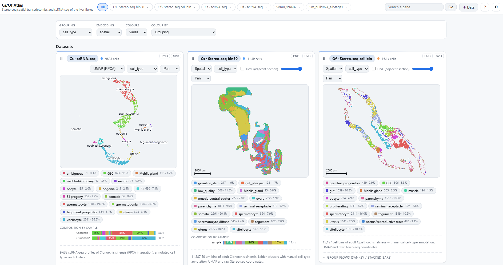
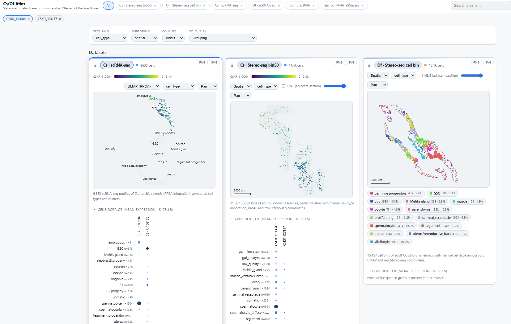
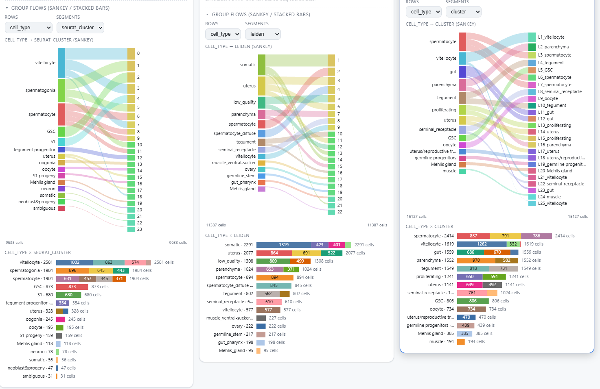
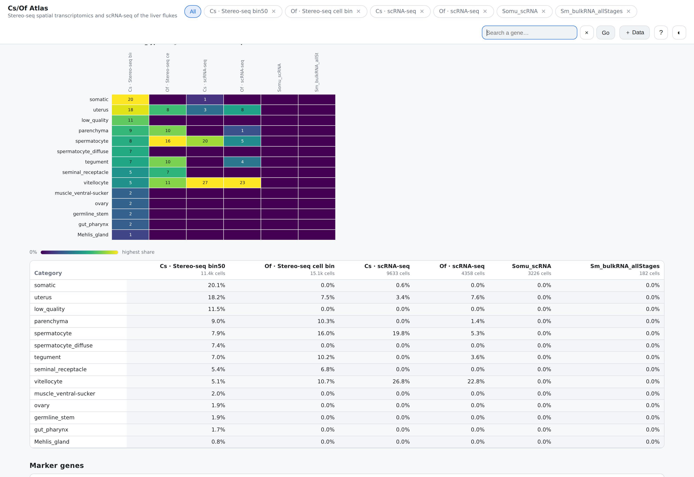
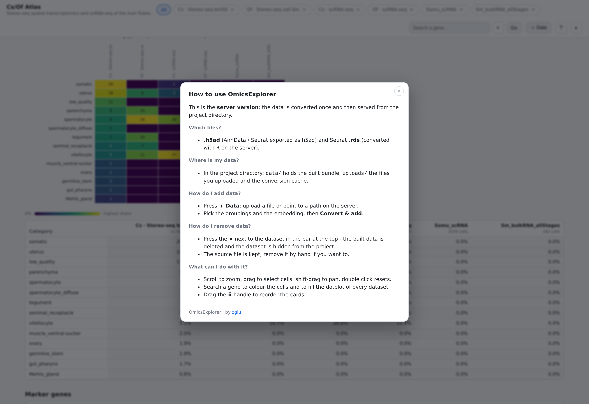

# OmicsExplorer

A **local** visualisation platform for single-cell and spatial omics, supporting **multiple datasets** at the same time.

Point it at one or more `.h5ad` files and you get an interactive web app:
every embedding of a dataset (UMAP, PCA, **spatial**), any metadata grouping as
a colour, gene expression queries, marker dot plots, composition tables and a
cell-type explorer - all in the browser, all served from your own machine.

The same bundle can be exported as a **static folder** and hosted anywhere
(GitHub Pages, Netlify, a university web server, S3) - the frontend is a plain
static site with no build step.

```
h5ad  ──▶  omicsexplorer build  ──▶  data/  ──▶  omicsexplorer serve  ──▶  browser
                                                     │
                                                     └──▶ omicsexplorer export ──▶ dist/ (static)
```



---

## Features

| | |
|---|---|
| **Datasets** | any number of `.h5ad` files (and Seurat `.rds`), grouped into species, added or removed from the UI |
| **Embeddings** | every 2-D embedding in `obsm`, switchable per dataset (UMAP ⇄ PCA ⇄ **spatial**) |
| **Groupings** | any `obs` column as a colour, with a stable palette per grouping, a legend with counts, and click-to-hide |
| **Quantitative metadata** | `nCount_RNA`, signature scores and other numeric `obs` columns colour the cells (viridis ramp) |
| **Spatial** | raw coordinates, bin-grid tiles vs cell dots, µm scale bar, histology image overlay with an optional affine transform |
| **Interaction** | WebGL2 point cloud: wheel zoom (anchored at the mouse), drag select, shift-drag pan, double click reset, hover tooltip |
| **Gene query** | search by id, id suffix, prefix or description; feature plot in the *current* embedding, and a dot plot per dataset (mean expression · % cells, per gene or absolute) |
| **Group flows** | the sankey and the stacked bars of two groupings, inside every card |
| **Markers** | Seurat-style ROC statistics (`myAUC`, `log2FC`, `pct.1`, `pct.2`) and a dot plot that shows every marker in *every* category |
| **Compare** | composition heat map + table across all datasets, with a reference dataset and a canonical cell-type ontology |
| **Selection** | brush a region and get its composition, with a legend and totals |
| **Runs anywhere** | a Python server, a Docker/Apptainer image, or a plain static site that parses the `.h5ad` **in the browser** |
| **Export** | every figure as PNG or SVG |
| **Dark / light** | theme aware, canvas included |

---

## Screenshots

All the pictures below were taken from the author's own (unpublished) dataset
of the liver flukes, served with `omicsexplorer serve`.

### The datasets

Every dataset is a card: its embedding, the metadata grouping, the legend with
the cell counts and the composition per sample.  The cards can be dragged into
another order and are shown side by side.


### Gene queries and dot plots

A gene (or a prefix of many) colours the cells of every dataset that contains
it, and every card gets a dot plot of the query: one row per category, the
dot size is the share of expressing cells, the colour the mean expression -
per gene or on one absolute scale.



### Group flows

Inside a card two groupings can be compared: the sankey shows how the cells of
one grouping flow into the other, the stacked bars below it the same split
with the cell counts.



### Comparing the datasets

The compare section puts all datasets next to each other: the composition of
every dataset per category of the reference dataset, as a heat map and as a
table.



### The built-in help

Every installation explains itself: the `?` button shows which files are
supported, where the data is stored and how to add or remove a dataset.



---

## Install

### Docker (recommended - nothing to install on the host)

```bash
git clone <this repo> OmicsExplorer && cd OmicsExplorer
./docker/build.sh                     # or: docker build -t omicsexplorer .
docker run --rm -p 8080:8080 -v "$PWD/my_project:/project" omicsexplorer
# -> http://127.0.0.1:8080
```

The build script also removes the image of the previous build (it would stay
behind as a tag-less `<none>` entry otherwise).

The image contains R + Seurat, so Seurat `.rds` files can be uploaded through
the web UI.  The mounted directory holds everything:

```
my_project/
├── project.yaml      # the project manifest (created for you if missing)
├── data/             # the built web bundle
├── uploads/          # the files you upload
└── .oe_rds_cache_*/  # their conversion cache
```

or with compose (it runs as your own user, so the files stay yours):

```bash
OE_PROJECT=~/my_project docker compose up --build
```

Smaller image without R (`.h5ad` only):

```bash
docker build --build-arg WITH_R=0 -t omicsexplorer:slim .
```

### Apptainer / Singularity (HPC, clusters, no Docker)

```bash
docker build -t omicsexplorer .                       # once, where Docker is available
apptainer build omicsexplorer.sif docker-daemon://omicsexplorer:latest
apptainer run --bind "$PWD/my_project:/project" omicsexplorer.sif
# -> http://127.0.0.1:8080
```

`docker/apptainer-build.sh` does both steps in one go.  The container never
writes outside the bound directory, so it also runs on a read-only cluster
filesystem.

### As a website, without any server

The app also runs as a plain static site: the user picks an `.h5ad` in the
browser, the file is parsed and converted **on their own machine** and the
result is cached in the browser (IndexedDB).  Nothing is uploaded.

```bash
python3 -m http.server 8080 --directory web   # or copy web/ to any static host
```

See [`docs/LOCAL_WEB.md`](docs/LOCAL_WEB.md) for the details and the limits.

### From source

```bash
git clone <this repo> OmicsExplorer
cd OmicsExplorer
python3 -m venv --system-site-packages .venv      # or: pip install -e .
.venv/bin/pip install -e ".[server,analysis]"
```

Requirements: Python ≥ 3.10 with `anndata`, `h5py`, `numpy`, `pandas`,
`pyarrow`, `scipy`, `pyyaml`.  `fastapi` + `uvicorn` for the local server
(`omicsexplorer serve`).  Seurat `.rds` support additionally needs R with
`Seurat` + `SeuratObject` (`convert_rds.r`).

## Quick start

```bash
# 1. describe your data
omicsexplorer init my_project        # writes my_project/project.yaml
$EDITOR my_project/project.yaml

# 2. convert the h5ad files into the web bundle
omicsexplorer build -p my_project/project.yaml

# 3. compute the marker genes (optional but nice)
omicsexplorer markers -p my_project/project.yaml

# 4. serve it
omicsexplorer serve -p my_project/project.yaml
# -> http://127.0.0.1:8080
```

The smallest project is a single file:

```bash
omicsexplorer init my_project        # writes my_project/project.yaml
# point it at your .h5ad, or just use the web UI (+ Data)
omicsexplorer serve -p my_project/project.yaml
```

The screenshots below come from the author's own dataset (Stereo-seq and
scRNA-seq of the liver flukes).  It is unpublished, so neither the data nor
its manifest are part of this repository - copy the manifest section below
into your own `project.yaml` to reproduce the same view.

---

## The project manifest

`project.yaml` is the only thing you normally have to edit.

```yaml
name: My atlas
subtitle: single-cell and spatial data of ...

# optional: prefix every dataset path with this directory
data_root: /data/my_project

species:
  hs:
    name: Homo sapiens
    color: "#4f9cf9"

# canonical cell types: the first name of a list is the display name, the
# others are the annotations that map onto it (used by the comparison table)
ontology:
  cell_types:
    neuron: [Neuron, neuronal, Neural]
    T cell: [T_cell, T cell, tcell]

datasets:
  - id: sample1_bin50
    name: Sample 1 · Stereo-seq bin50
    species: hs
    kind: spatial            # spatial | umap
    path: ../data/sample1.h5ad
    description: One sentence about the dataset.
    units: um                # the physical unit of the spatial coordinates
    bin_size: 50
    default_group: cell_type
    default_embedding: spatial

    # the metadata columns that can be used as a colour
    groups:
      cell_type:
        column: cell_type_manual    # the obs column
        label: Cell type             # the name shown in the UI
      sample:
        column: orig.ident
        label: Sample

    # the embeddings that can be shown
    embeddings:
      spatial:
        kind: spatial
        obsm: spatial                # an entry of obsm
        label: Spatial
      umap:
        kind: umap
        obsm: X_umap
        label: UMAP
      pca:
        kind: pca
        obsm: X_pca
        dims: [0, 1]                 # which columns to use
        label: PCA

    # a background image for the spatial view (histology, H&E, ...)
    images:
      - path: images/he.png
        label: H&E
        transform:                   # optional: image pixel = data * scale + translate
          scale: [0.0125, -0.0125]
          translate: [10, 2200]

    # optional: a "gene id <tab> product" table; the search box then also
    # finds genes by their description
    gene_details: tables/gene_product.txt
```

Everything that is not given is auto-detected: embeddings come from `obsm`,
groupings from the low-cardinality `obs` columns.

`kind: spatial` only changes the presentation (no labels on the canvas, a
scale bar, tiles instead of dots).  Any 2-D `obsm` entry can be used.

---

## Deployment

The frontend is a static site - there is no backend in production.

```bash
omicsexplorer export -p my_project/project.yaml -o dist
```

`dist/` contains `index.html`, `src/`, `vendor/` and `data/` and can be hosted
by any static server **that supports HTTP range requests** (the expression blob
is read gene by gene with a range request):

```bash
omicsexplorer serve-static -d dist 8080   # the bundled server, range enabled
```

> `python3 -m http.server` does **not** support range requests, so the gene
> panel stays empty with it.  nginx, Caddy, GitHub Pages, Netlify and S3 all
> handle ranges correctly.

Details, including the data format and how to reduce the size of the bundle,
are in [`docs/DATA_FORMAT.md`](docs/DATA_FORMAT.md),
[`docs/DEPLOY.md`](docs/DEPLOY.md) and [`docs/SPATIAL.md`](docs/SPATIAL.md)
(the spatial / Visium support).  The container workflow (Docker,
Apptainer, HPC) is documented in [`docs/DOCKER.md`](docs/DOCKER.md).

---

## How it works

```
web/                     the frontend - plain ES modules, no build step
  index.html
  styles/app.css
  vendor/                hyparquet + html2canvas (vendored)
  src/
    core/                data layer, palette, gene search, composition maths
    views/               scatter (WebGL2), charts (heat map, dot plot, violins)
    app.js               the panels: datasets, compare, explorer, markers, genes
omicsexplorer/            the Python package
  config.py              project.yaml
  h5ad_io.py             low level h5ad readers (gene-major matrix)
  blob.py                the X.bin codec
  converter.py           h5ad -> bundle
  markers.py             Seurat-style marker statistics
  server.py              FastAPI app (static + range + JSON API)
  cli.py                 omicsexplorer init | build | markers | serve | export
```

The important design decision: **the local server and the deployed site read
exactly the same files**.  `serve` mounts the bundle under `/data` and the
frontend under `/`; `export` copies both into one folder.  There is no second
code path and no chance of the deployed site behaving differently from the
local one.

### The expression blob

`data/<dataset>/X.bin` stores the expression matrix **gene major**: one gzip
member per gene.  The browser fetches a single gene with one HTTP range
request and inflates it with the native `DecompressionStream('gzip')`.

The format is byte-compatible with the `nematode-atlas` project, so blobs and
apps can be mixed freely (there is a test for it).

---

## Tests

```bash
.venv/bin/python -m pytest tests -q        # converter, codec, manifest
node tests/e2e.mjs                         # browser end-to-end (needs a server)
node tests/e2e_add.mjs                     # the "add dataset" flow
node tests/e2e_local.mjs                   # the browser only mode (no server)
node tests/smoke.mjs                       # quick browser check
```

The browser tests use puppeteer; set `PUPPETEER_PATH` or `npm i puppeteer` if
it is not installed already.

---

## Author

OmicsExplorer is designed and developed by **zglu**
(<https://github.com/zglu>), with the power of AI.

## Licence

MIT.
